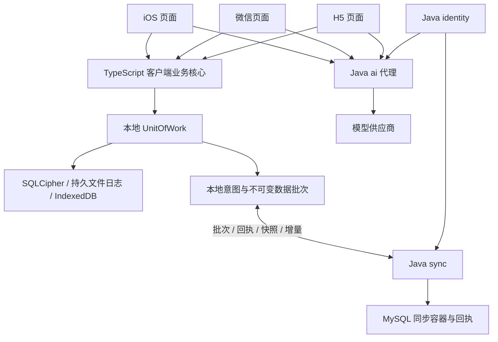

# 多客户端、本地共享核心与 Java 云服务

版本 v1.0，2026-10-16，目标设计工作版。范围：[需求与差异](../requirements/README.md)；工程：[目录分工](../engineering/directory-structure.md)。

## 1. 运行边界

iOS 使用 React Native/Expo 开发构建与 SQLCipher，微信/H5 使用 Taro/React，分别适配持久文件日志和 IndexedDB。具体兼容版本待工程初始化锁定。TypeScript 业务处理端是各客户端内的共享库，不是另建远程业务服务器；Java 云服务不引用它。

不存在 Java 到本地核心的调用，也没有 TS 网络业务服务。云端数据库不镜像 95 张业务表；收到的 changes 以受控数据容器保存，不按表名拼 SQL。

## 2. 数据与职责

| 能力 | 客户端 | Java 云端 |
| --- | --- | --- |
| 资料、计划、训练、睡眠、学习、摄入、复盘 | 唯一业务规则、命令、查询、事务、确认、统计和历史 | 不运行，不提供业务 CRUD |
| 注册与会话 | 输入、凭据安全保存、当前账户/用途快照 | 唯一账号、哈希、会话、撤销和归属 |
| AI | 冻结最小输入、来源、候选接纳与显式确认 | 凭据、任务/模型调用、格式、额度及结果 |
| 同步 | 变化捕获、队列、导入校验、重放与冲突选择 | 结构/归属/版本/摘要/幂等、原子保存与读取 |
| 附件与备份 | 业务关联、本地加密导出恢复、完整性说明 | 仅 AI 临时图片或 sync 通用附件，不增业务备份调度 |

本地持久业务库是日常执行位置；本地已保存与云端已保存分别显示。账户级 headVersion 只表示云端存储顺序，不能代替聚合版本、来源 token 或确认状态。云端 STORED 不证明载荷业务正确。

## 3. 核心分层与依赖

profile 保存条件与身体观测；planning 保存目标、草案、审查、发布和保护；execution 保存事实和食物草案；review 保存结论、判断与确认；workspace 组合读模型。健身和学习在这些域内部通过明确类型和策略扩展，不新建独立健身服务。

profile 为基础支撑；planning 通过公开快照读取 profile；execution 调用 planning 保护基准；review 读取三域快照。planning 的限制证据、调整依据由它定义端口，execution/review 在客户端组合根提供实现，避免 planning 静态反向依赖。workspace 只经公开查询接口读取。

业务核心不持有连接、HTTP、React/Taro/Expo、文件或界面状态。数值采用显式精度和单位；日期采用业务日期与 UTC 时间，时钟/ID/账户/策略由 ExecutionContext 注入，重放不随系统隐式时间改变业务含义。

## 4. 首期范围与边界

保留目标—计划—事实—日周复盘闭环、原基准、不可变修订、未知值、来源失效、人工确认与本地备份。增加用户名/密码注册。找回密码、邮箱/短信、绑定、云端业务审核、营养服务和完整跨副本隐私编排不自动扩展；相关旧用例的范围降级须公开记录，不能因旧文档存在就宣称已交付。

Windows 阶段可开展 TS 核心、Java 云端及 Taro 实现；iOS 原生构建、签名和 SQLCipher/锁屏/后台实际验收仍安排在后续 Mac 与 iPhone 环境。本轮不锁定依赖、不声明构建或设备测试通过。
