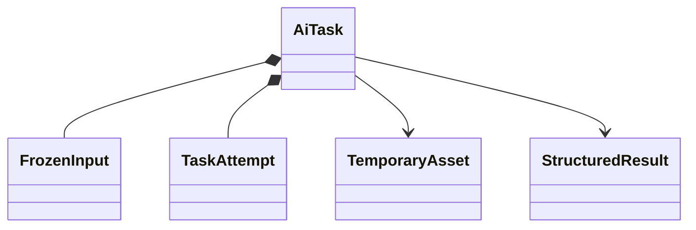

# ai：技术任务与结果模型

任务 QUEUED → RUNNING → SUCCEEDED/FAILED/CANCELLED；同步/异步模式在实际模型耗时确定后选择。多次尝试通过 leaseToken/attemptVersion 拒绝旧 Worker 覆盖。外部调用不占 MySQL 事务，事务前后检查当前访问资格；无法取消的供应商请求，其迟到结果不能恢复已受限输入。

幂等键按账户与 clientRequestId 唯一，绑定 inputDigest、协议版本和模型能力；同键不同输入拒绝。重试不承诺供应商恰好一次计费。结果携带模型/提示/输出 Schema 版本、inputDigest、原样来源元数据；不宣称这些来源已由云端领域校验。

客户端候选状态与 Java executionStatus 分离：客户端 SOURCE_STALE/REJECTED/ACCEPTED 不是 Java 数据事实。若未来上传接纳遥测也不能授予业务成功或确认状态。供应商不可用明确返回错误，不自动 mock。

图片为 AI 临时受限输入，校验归属、格式、大小/寿命；服务端不维护 MealRecord/食物份量。临时文件清理与账号访问保护属设施，不假称跨供应商副本已全部删除。
