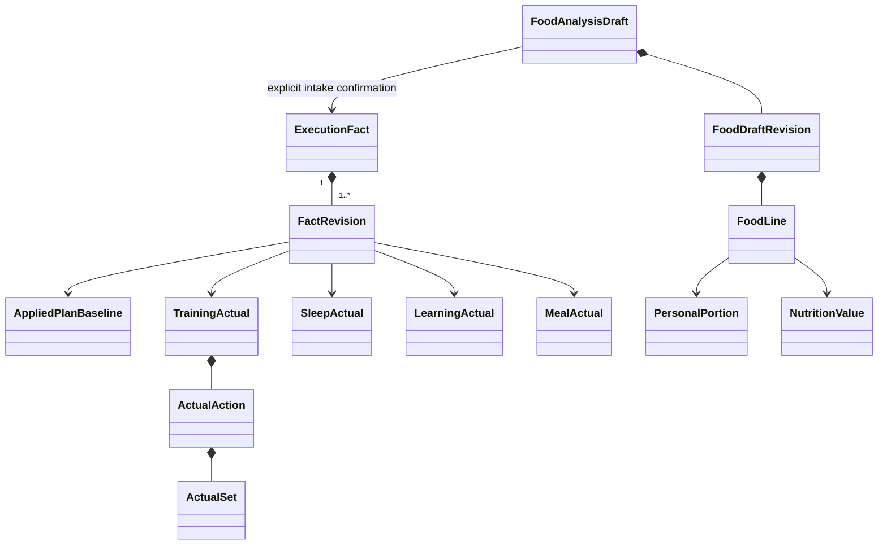

# execution：模型、状态与事实规则

事实稳定头与不可变完整修订；纠正用同 factId 替换当前指针，旧版不重复累计。ACTIVE → REMOVED 后退出有效查询，重复删除幂等。训练/学习的完成、部分、明确未执行、未登记分别表达，不能从计划补实际组数或由“未填写”推导未执行。

训练允许只记录 PARTIAL、时长和感受，不要求填写所有动作；实际动作/组/单位按用户输入保存。学习按分钟/页/题分开，文字成果可以没有数量，不能由时间推掌握率，不能把同时填的 duration 与分钟片段重复累加。

睡眠 START 为 IN_PROGRESS，真实 beginAt 已发生、endAt 未知，预计起床日 provisional；finish 更新同一事实为 COMPLETED，按真实起床日归属，保留原开始保护，更新旧/新日 token。未完成不参与完整睡眠时长。纠正移日保留原基准并标 baselineDateMismatch，补充新日保护，不伪造新日达标率。

FoodAnalysisDraft 的输入图片集合/用户说明变化使旧候选过期；同餐多图是同一草案的证据，不按照片重复累计。一次个人摄入确认核验草案版本、个人份量和未知项，唯一关联有效 factId；重复确认不再次增加小计。

营养值保留 KNOWN/ESTIMATED/UNKNOWN、区间、单位、来源原值、份量基准和换算版本；未知不为 0，个人半份按实际份量计算，不把整盘全计个人。修正草案未确认保持原事实；确认后新修订替换原值。小计说明餐次覆盖，不将缺餐的小计称全天实际，也不因超出自动改饮食目标。
