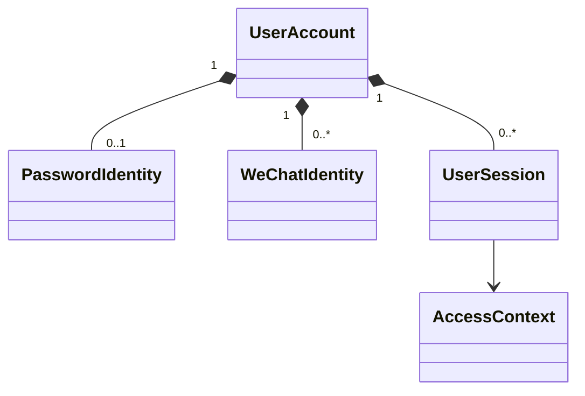

# identity：模型与状态

UserAccount 至少区分 ACTIVE 与 DISABLED，历史 CLOSED/CLOSING 按迁移原义映射，不反推完整清理完成。PasswordIdentity 一账户最多一条，规范用户名全局唯一；大小写/Unicode/长度规范在初始化协议中固定并测试，不能交由数据库默认排序隐式决定。

注册在事务外完成输入/密码策略及哈希计算，短事务插入账号/身份并提交；唯一约束竞争只允许一个成功，失败整体回滚，不留下可登录半账户。密码哈希算法/参数初始化时确定，旧 BCrypt 兼容要独立验证，不以“Java 相同”假定兼容。

会话只保存凭据摘要或等价安全验证材料，客户端秘密放安全存储；原始密码、哈希与 token 不入普通日志/业务备份。过期、撤销、停用立即限制新云端请求；离线客户端不能即时知道云端状态，联网前先核验。

用途/访问资格在 AI 发起/结果读取和同步入口必要检查，不能给 Java 增添计划发布/复盘确认资格判断。本地已有内容是否可离线查看由设备解锁策略明确，不能把云端会话过期直接等同本地删库。
