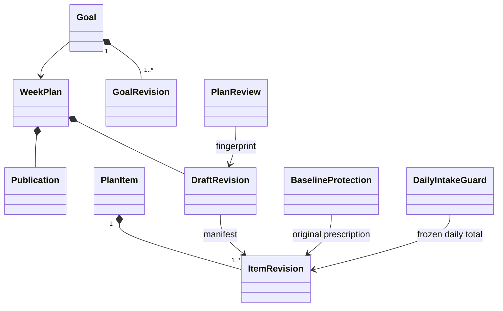

# planning：聚合、审查与历史保护

目标 ACTIVE → PAUSED → PENDING_REPLAN → ACTIVE，恢复须重新规划、审查和发布未来范围；ARCHIVED 不在首期恢复。已存在计划时不换类别，新目标修订不改旧基准的目标名称/分母。

同账户/目标/周唯一本 WeekPlan；同周项目身份由不可编辑 slotKey 定位，不用标题作键。Draft manifest 引用完整不可变项目修订，未改项目复用旧引用。发布只原子切换用户选择的 selectedItemIds，明确每项预期原修订；其他日期/目标保持。

草案 EDITING → REVIEWING → READY/NEEDS_CHANGE/INSUFFICIENT/FAILED；草案、条件、规则、范围或调整依据变化使审查 STALE。RULES 渠道由批准的版本化确定策略形成完整覆盖；AI 渠道额外等待最新 AI 结果。AI 失败不能自动降级通过；显式切换 RULES 重新审查，保留已识别禁止项。规则渠道取舍仍为待正式冻结的设计工作项，不视为健康政策已批准。

| 保护范围 | 不变量 |
| --- | --- |
| TRAINING/LEARNING | 真实开始或任何已保存实际（含明确未执行）冻结处方与目标修订；不把计划组数补成实际 |
| SLEEP | 根据真实开始与起床日保护，周日夜已开始睡眠不因跨周修改而重写 |
| NUTRITION_TOTAL | 同账户/日首次摄入冻结相关目标总量或无目标状态，后续不增删替换当日总量 |
| MEAL | 已开始/已摄入餐次不变；未开始餐次可在总量和已保护份额不变时调整 |

PublishableRangePolicy 只允许未来、未开始、无实际范围；CrossGoalConflictPolicy 返回具体冲突，用户选择，不自动排程。WorkoutPrescriptionPolicy 校验动作顺序/名称/数量单位/休息；LearningPrescriptionPolicy 按独立单位。NutritionTargetPolicy 无批准方法/必要参数不生成个性化数值；MealAllocationPolicy 显式未知、未分配和一致性；FitnessRestrictionPolicy 返回 ALLOWED/WARN/BLOCKED/INFORMATION_REQUIRED，不让用户本地开关或 AI 越过阻断。

调整以 oldValue/newValue/reason/affectedDate 三方合并，逐周处理，KEEP_CURRENT/USE_PROPOSED/CUSTOM 明确选择。合并保存草案不发布，源失效不改已发布未来计划。
