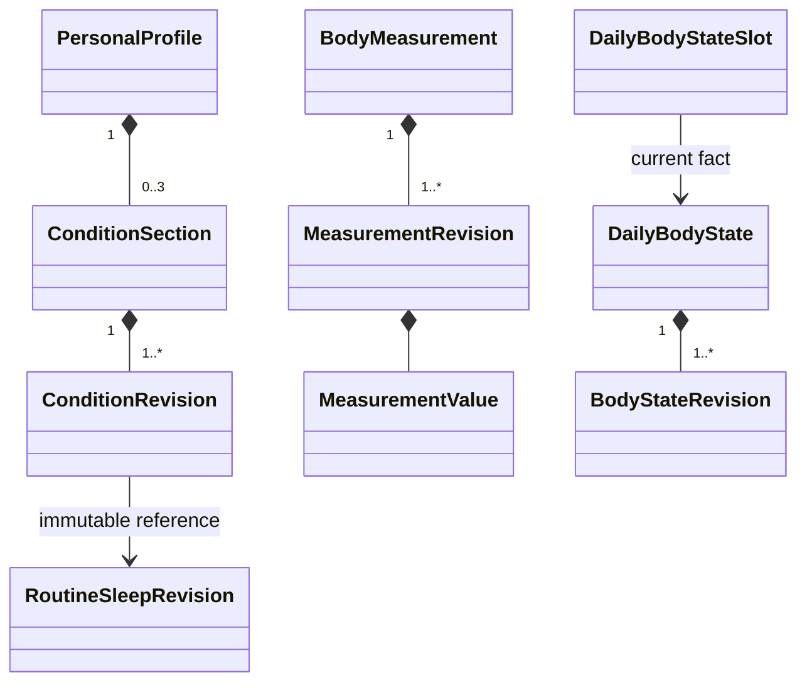

# profile：聚合、状态与规则

PersonalProfile 编辑一个分区时核验根 expectedVersion，updateMask 未包含字段保持，显式 null/空数组才清空选定组件。新修订保存完整合成内容，未改作息复用其修订 ID；无内容变化不增加版本/token。常规作息与可用时间不生成训练/学习安排。

BodyMeasurement 同次观测至少一项，单位显式，围度带部位；同日允许多次，latest 是投影。businessDate 必须匹配 observedAt 的上海日期，禁止未来真实观测，时间来自可控本地 context，不继续依赖旧服务器产生业务时间。无批准健康阈值时不推断“正常”。

DailyBodyState 同账户同日最多一个 ACTIVE，所有维度 UNKNOWN 不可保存；纠正移日检查目标槽，已占用返回 BODY_STATE_DAY_OCCUPIED，不能覆盖。测量/日状态纠正保留 factId，追加不可变修订，并更新原/新日 token。

事实 ACTIVE → REMOVED；普通删除追加 REMOVE，不参与最新值或统计。REMOVED 不接受纠正，返回 FACT_REMOVED；重复删除幂等不再改版本。普通事实独立成立，风险证据不会阻止如实记录；planning 基于公开证据限制未来任务，profile 不作医学诊断。
