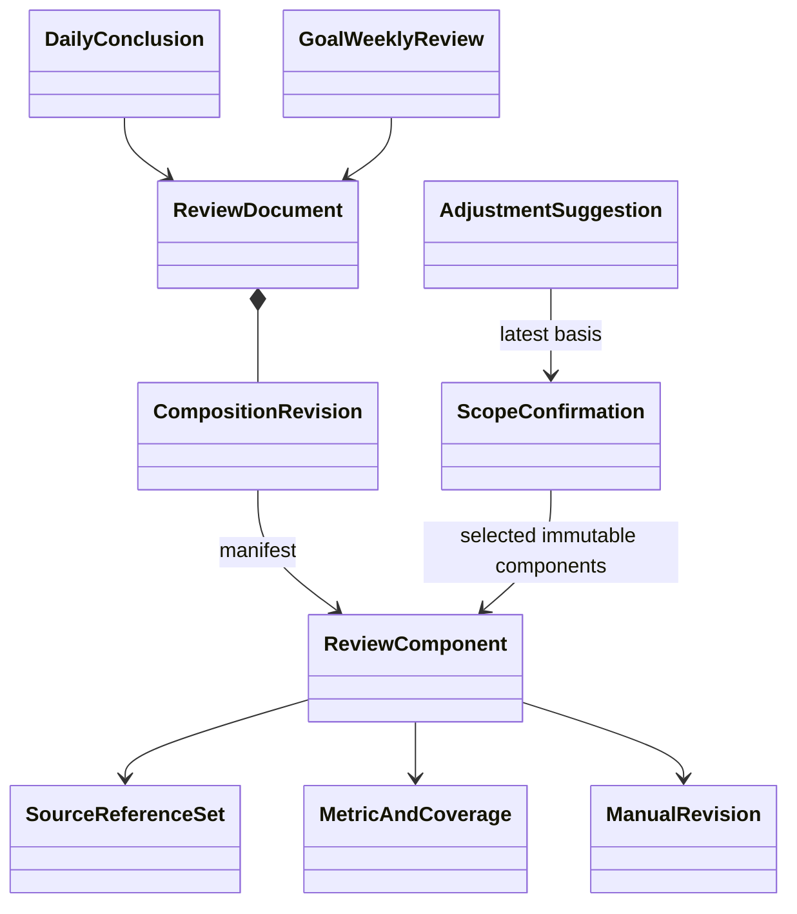

# review：组件、来源与确认

DailyConclusion 每账户/日唯一，GoalWeeklyReview 每账户/目标/周唯一。组件 slot 为 GOAL、HEALTH/LEARNING 总览或自主范围；未涉及组件复用旧 ID，避免学习局部修改抹掉健康范围确认。组合修订不可变，确认针对明确组件，不设单一全根“已确认”二值状态。

内容 SUMMARY_ONLY/GENERATING/GENERATION_FAILED/AWAITING_CONFIRMATION 与来源 FRESH/STALE、范围确认独立。人工补充形成新人工修订，使旧机器判断需更新；显式 MANUAL_FINAL_JUDGMENT 重新采集最新来源/覆盖后可确认，无 AI 时仍可手工闭环。AI 不能覆盖人工条目。

确认需 explicitConfirm、组件清单、来源指纹、cutoff、coverage 与预期版本。查询“最新已确认”实时核验原对象修订与范围 token，包括原来为空的日/维度。周结论同时读目标/逐日原基准、底层事实、七日日组件与确认状态；不等七天确认才可生成，也不只拼接 AI 文本。

组件不得引用本根自己的 token；MANUAL 只因人工条目变化递增，确认不改它。确认可增加根 version 而不改内容 revisionId；调整 basis 绑定当前组合修订及仍在 manifest 的当前确认组件，不能扩张原确认范围。

训练四状态、摄入已记录小计/未知/餐覆盖、睡眠起床日、身体时间单位、学习各单位分别对照。无基准为 NO_BASELINE；事实移日/原基准不匹配时 comparability=UNAVAILABLE，不造达标率。未来/休息/暂停按适用范围排除分母；共享事实总览按 factId 去重。AI 不修改确定性 metric/coverage。

AdjustmentSuggestion GENERATING → READY/FAILED/STALE，DISMISSED 或逐周 SUBMITTED；每条有原值/新值/理由/影响日期/statementRef。提交前再次核验最新确认与规划限制，只合并未来无实际范围。保存/确认/历史纠正不自动改已发布计划。

2026-10-20 实现增量：review-metrics-v2 已实现原目标修订的计划对照、分维度应登记/漏记/未来/休息/暂停、实际动作/时长、独立学习单位、睡眠完成状态、营养区间与逐日覆盖、同单位身体描述，以及周输入的逐日日结论状态。无时段当前日不提前记为漏记，过日后才进入分母。来源变化同事务生成/刷新日摘要并更新已有依赖周，保留人工历史且不恢复旧确认。旧指标版本和损坏冻结输入不能授予最新确认/接纳资格；决定见 [ADR-006](../../adr/ADR-006-deterministic-review-derivation.md)。
