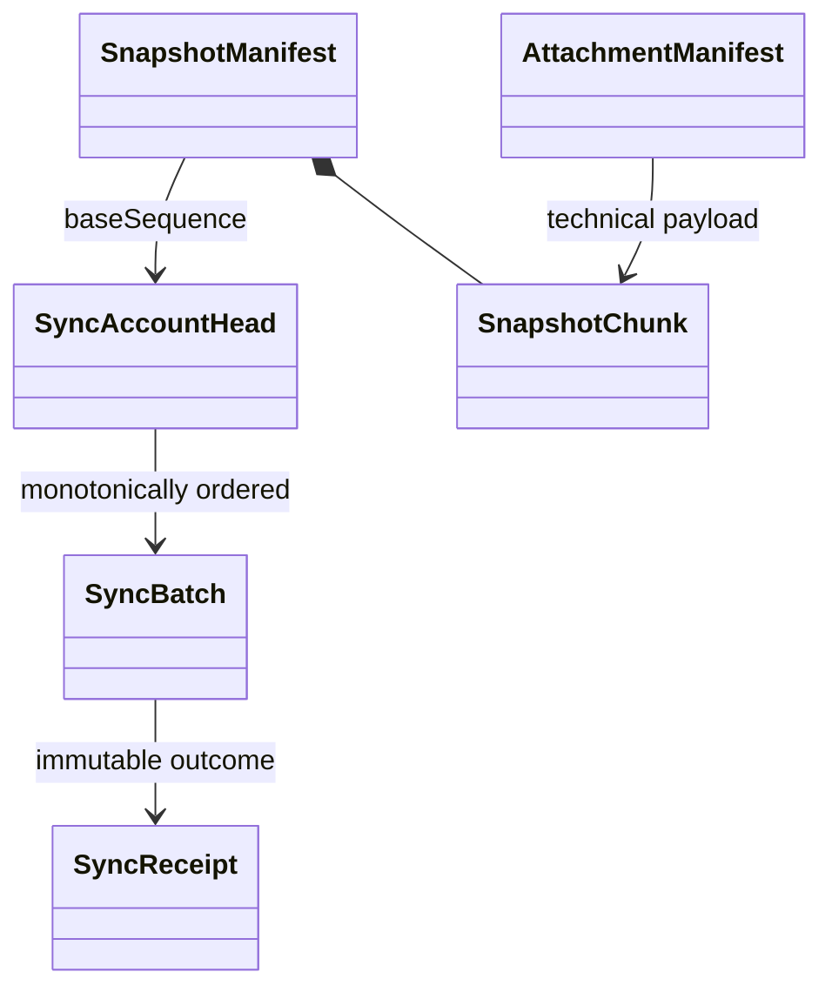

# sync：版本、幂等与快照模型

账户初始头与同步根状态单独建模。批次 expectedHeadVersion 等于当前头才可保存，每成功批次推进一次；并发不同对象仍返回冲突。相同 account/batchId 相同摘要返回原回执，同 ID 不同请求拒绝，冲突重提必须新 ID。

事务按账户同步头锁串行保存完整载荷/回执/新头，任一失败全部回滚。身份访问检查与幂等回放都不能暴露被停用或其他账户内容；旧会话不能恢复受限制数据。

快照 TEMPORARY → COMPLETE，缺块、摘要失败或基线不匹配不得发布。仅当前同步基线且无待同步操作的客户端可产生可恢复基线，服务器检查版本/摘要而不证明业务语义。新根初始化只限未建立根账户，后续不能覆盖现有序列。

连续 sequence 的拉取与保留基线共同保证可恢复；裁剪/配额不得令唯一副本不可恢复。附件、照片原文和结构化内容完整性分别标记。
