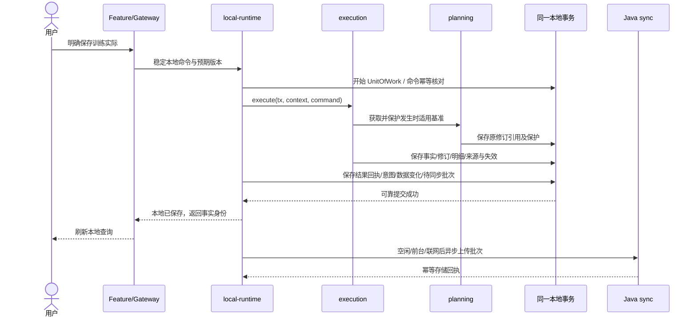

# 本地事实保存与原基准

自主事实无基准时不创建假目标。任何本地写失败整体回滚，不单独提交保护或提前显示成功；云端断网/AI 失败发生在业务事务外，不回滚事实。纠正保留同 factId/原基准，旧新归属范围都变化，review 的相关确认需更新，未来计划保持。

验收目标：已发布计划 → 事实保存 → 原基准可追溯 → 相关结论需更新 → 重启可读 → 批次重试不重复。单纯自主训练成功不能替代该闭环。
