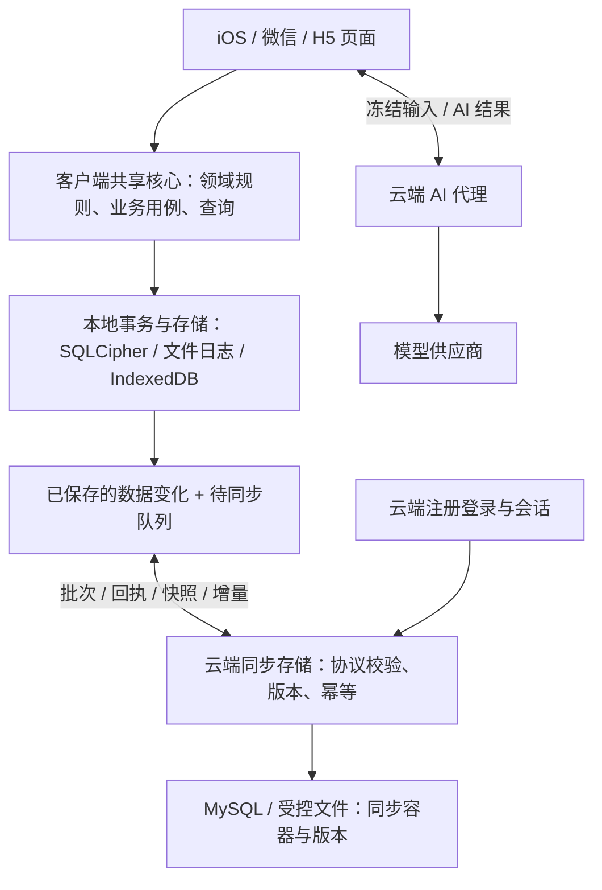

> 历史阅读副本（2026-10-16）：保留旧需求/设计语义，未复制的附件链接指向原工程。旧服务端处理、旧实现状态和测试结论不适用于新工程；当前范围以新工程 docs/requirements/README.md 和架构 ADR 为准。仅此说明与链接经过整理，源文件摘要见归档清单。

# EvoLoop 新项目客户端本地业务重构说明

| 项目 | 内容 |
| --- | --- |
| 版本 / 日期 | v1.1 / 2026-10-16 |
| 文档状态 | 新项目目标设计与实施要求；尚未创建新项目代码、迁移或部署 |
| 本次调整 | 业务规则与用例统一在客户端；服务端首期仅负责注册登录、AI 对接及同步数据接收存储 |
| 替代范围 | 替代 v1.0 中“云端引用业务核心、重执行业务命令、MySQL 业务仓储”的设计 |
| 当前代码基线 | 当前仓库 `81f4fe4` 与工作区文档调整；旧工程保持原状 |
| 配套规范 | [新项目工程目录与代码分工规范](15_新项目工程目录与代码分工规范_20261016.md) |
| 业务依据 | [整体领域设计](03_后端领域设计/00_整体业务领域设计.md)、[业务规则](../需求/04_公共规则/业务规则清单.md)、[用例清单](../需求/03_功能用例/用例清单.md) |
| 当前实现参照 | [当前工程规范](<D:/project/pri/EvoLoop/docs/技术架构/02_工程目录与代码规范.md>)、[双端本地优先实现记录](<D:/project/pri/EvoLoop/docs/技术架构/13_双端本地优先实现与验证_20261015.md>) |

## 1. 目标与首期范围

新项目采用“客户端本地业务核心 + 轻量云服务”。iOS、微信小程序与 H5 共享 TypeScript 本地业务实现，分别使用 SQLCipher、持久文件日志和 IndexedDB。服务端暂以 Node.js/Fastify 承载账号、AI 代理和同步存储模块，但不加载本地业务核心，也不以 Node.js 再实现计划、训练、饮食或复盘用例。

手机是日常业务数据的直接来源和执行位置。初始化后，页面查询、手工编辑、保存、计算、规则审查、业务历史、人工确认和冲突处理均在客户端执行。同步为异步数据传输；“本地已保存”和“云端已保存”分别展示。

首期云服务严格限定三类职责：

1. **注册登录**：用户名/密码注册、登录、会话、账号归属和必需的访问控制；既有微信登录按迁移需要适配。
2. **AI 模型对接**：保管供应商凭据，接收客户端明确提交的输入，调用模型，返回结果/任务状态及必要调用记录。
3. **用户数据同步**：接收客户端生成的数据批次/快照，按账户持久保存、返回幂等回执；同步范围内提供初始化下载、增量拉取和恢复读取。

账号、AI 和同步自身需要的格式、大小、认证、所有者、版本、摘要、幂等及限流检查仍在服务端；它们属于接口和存储约束。服务端不判断“训练是否合理”“计划能否发布”“复盘是否可确认”，不重算业务指标、不做领域命令重放、不执行业务来源失效传播。

注册明确纳入首期，覆盖此前 v1.0 的“管理员预建、不新增注册”约束。找回密码、账号绑定、手机号/邮箱验证等仍不自动扩展。服务端不增加独立营养来源、业务查询、业务审核、自动调整、业务备份调度或隐私编排子系统；本地加密备份保留，云端数据库/文件的基础运维保护属于同步存储维护，不等于新增业务能力。

## 2. 主要变化与不变约束

| 原 v1.0 设计 | 调整后 | 完成证据 |
| --- | --- | --- |
| 云端和客户端引用同一个业务核心 | 仅客户端引用 `client-business-core` | 云端依赖图及产物没有业务核心/客户端运行时 |
| 上传业务命令、云端重新执行 | 上传已经由客户端计算的数据变化批次/快照 | 服务端只做协议/存储检查，未调用领域处理器 |
| MySQL 实现计划/事实/复盘仓储 | MySQL 只保存账号、AI 状态及同步容器/回执 | 云端没有领域 Repository 或业务表 CRUD 接口 |
| 冲突由云端规则处理 | 云端报告版本冲突，客户端执行业务重放及人工选择 | 原分支保留、重新生成批次、无静默覆盖 |
| 首期不增加注册 | 增加用户名/密码注册及登录 | 唯一账号、密码哈希、会话、跨账号隔离测试 |
| 多种存储对同一业务用例做等价验证 | 客户端 SQLite/日志/IndexedDB 对同一用例验证 | 旧 Java 仅用作迁移期业务基线 |

保留的约束：客户端共享一份业务规则；数据本地持久化；禁止整页逻辑集中在单个 `.ts`/`.tsx` 或巨型 Hook/Service；保留历史基准、修订、用途语义和人工确认；真实模式不回退 mock；迁移不丢弃旧设备未同步操作。原服务和业务库不在文档阶段切换。

云端存储成功只证明批次通过协议检查且已经落盘，不证明业务结论正确。业务正确性由客户端核心及恢复时的校验负责；首期不将同步数据用于云端计费、排名、自动裁决等依赖业务可信性的流程。未来需要云端业务核验时另有需求与 ADR，本期不预埋一套重复实现。

## 3. 技术与工程选择

| 部分 | 选择与要求 |
| --- | --- |
| 新工程 | 规划为 `evoloop-next` Monorepo，实际创建位置实施时指定；pnpm workspace、根级锁文件 |
| 客户端核心 | TypeScript 严格模式；领域、用例、查询、仓储端口分离，只由客户端装配 |
| iOS | React Native/Expo 开发构建、SQLCipher、Keychain；精确兼容版本初始化时锁定 |
| 微信/H5 | Taro/React，持久文件日志/IndexedDB；平台代码不进入业务核心 |
| 服务端 | Node.js 受支持 LTS + Fastify，账号/AI/同步三个模块的轻量单体 |
| 云端存储 | MySQL 存账号、AI 元数据、同步版本/回执/批次；大快照/AI 临时图片可接文件或对象存储端口 |
| 协议共享 | `contracts` 只含注册登录、AI、同步及错误契约；`data-schema` 的云端导出只含结构元数据和传输校验 |
| 本地命令 | 业务用例输入、版本转换和重放注册归 `client-business-core`，不成为云端可执行协议 |
| 验证 | 客户端业务等价、存储故障恢复；云端账号/AI/同步集成；跨端及真实设备验收 |

pnpm workspace 与 Expo 官方多工程支持用于共享客户端包；版本初始化时锁定并实际构建核对。[pnpm workspace](https://pnpm.io/workspaces)、[Expo Monorepo](https://docs.expo.dev/guides/monorepos/)。类型与构建边界参考 [TypeScript 项目引用](https://www.typescriptlang.org/docs/handbook/project-references)。Fastify 使用受控 Schema 校验传输输入，不将 TypeScript 类型当作运行时检查。[Fastify 校验与序列化](https://fastify.dev/docs/latest/Reference/Validation-and-Serialization/)。

共用 Schema 不包含业务决定。客户端和云端可以核对字段类型、精度、协议版本及载荷摘要，但“计划是否受保护”“确认来源是否过期”等逻辑只在客户端核心。各端 React 主版本服从 Taro/Expo 兼容组合，不强制一致。

## 4. 运行结构与职责

图中没有云端到业务核心的调用。业务共享发生在 iOS、微信和 H5 之间；服务器没有业务处理实例。

| 工作 | 客户端 | 服务端 |
| --- | --- | --- |
| 目标/计划/事实/复盘 | 全部规则、事务、历史、查询及人工确认 | 只存同步载荷，不执行这些用例 |
| 注册登录 | 输入、凭据安全保存、账号切换 | 账号、密码哈希、会话及请求归属 |
| AI | 冻结输入、业务来源、候选接纳、失效判断 | 凭据、模型请求、任务状态、输出格式及用量 |
| 同步 | 打包、队列、拉取、校验导入、冲突及重放 | 认证、版本比较、摘要、幂等、原子存储和读取 |
| 本地备份 | 密码加密导出/恢复、分支和附件清单 | 不增加独立业务备份模块 |
| 历史/统计 | 本地计算；必要时先下载历史数据 | 按游标/范围返回已存的数据容器，不生成业务页面结果 |

## 5. 客户端业务组织及不变量

`packages/client-business-core` 按 profile、planning、execution、review 与 workspace 组织。身份只保留客户端使用的当前账户/用途快照；AI 候选的业务接纳由各数据所有域负责。服务端账号及 AI 调用状态不进入本地业务表。

每域区分 domain（纯规则）、application（单用例）、queries（读模型）、ports（仓储/外部快照接口）和 public（公开能力）。跨域事务通过同一个 UnitOfWork 协调；业务核心不持有数据库连接、HTTP 对象或界面状态。

planning 通过 profile 公开快照取得条件；execution 通过 planning 公开能力保护原计划基准；review 读取 profile/planning/execution 公开快照。planning 核验调整依据由端口反向注入，避免静态循环。workspace 组合查询，不保存另一份事实。

必须保留：事实绑定发生时的计划修订；已开始/已有实际范围受保护；修改草案使旧审查失效；事实或人工判断变化使相关确认需更新；未知营养不记零；食物草案未确认不入账；睡眠归起床日；AI 只产生候选；确认摄入、确认复盘和发布计划分别进行。未批准的健身政策仍不能被本地开关或模型结果替代。

## 6. 一次本地保存与持久队列

以登记训练为例：表单生成明确的本地命令 → 客户端核心校验并执行业务 → 同一本地事务保存事实/明细/历史/原基准/来源变化 → 同时登记变化批次和重放意图 → 可靠落盘后返回“本地已保存” → 查询订阅刷新 → 后台异步上传。

本地命令拥有稳定命令类型和版本。实际网络批次包含最终规范数据变化；用户原始操作意图留在本地队列/备份中用于冲突重放，不要求服务器解释。命令与上传批次分开编号，不能用当前 JS 方法名作为持久协议。

核心只使用显式上下文中的时钟、ID、账户与策略。业务记录 ID 稳定，历史修订不可变；本地重放检查原预期版本，发布或确认失效时须重新向用户展示差异。日期、精确数值和单位不依赖界面文案或系统隐式转换。

保存后空闲、前台周期、网络恢复和重新打开均可触发同步；iOS 后台时机服从系统。网络失败不回滚本地事实。界面区分已保存未同步、正在同步、云端已保存、冲突、需登录和同步暂停。

## 7. 同步设计：保存数据批次，不执行业务命令

### 7.1 首期采用账户级版本比较

为避免在云端引入领域合并规则，首期为每个账户维护一个递增 `headVersion`；每个成功保存的数据批次增加一个版本，该版本同时用作下发 sequence。一个批次可以包含多表变化，整体保存或整体拒绝。

客户端提交 `expectedHeadVersion`。相同账户只有基于当前版本的批次可提交；另一设备已推进版本时返回冲突，不按字段合并、不按时间戳覆盖。这个粒度会让不同业务对象的并发修改也触发重新对账，是首期简化云端的明确代价。后续如需细粒度版本，另行设计通用冲突协议。

### 7.2 传输结构与存储容器

| 消息/容器 | 必备内容 |
| --- | --- |
| SyncBatch | protocolVersion、batchId、deviceId、expectedHeadVersion、payloadSchemaVersion、changes、payloadDigest；数据按客户端生成，不含可执行 SQL |
| Change | 逻辑表/对象名、主键、before/after 或明确 tombstone；定义于受控的同步结构 Schema |
| SyncReceipt | batchId、输入摘要、STORED/CONFLICT/REJECTED、serverSequence、错误码 |
| PullEnvelope | 连续 serverSequence、batchId、不可变规范载荷、摘要和结构版本 |
| SnapshotManifest | snapshotId、baseSequence、payloadSchemaVersion、分块摘要、所属账户及数据范围 |
| 本地命令记录 | 本地 commandType/commandVersion、参数、预期版本及依赖；不由云端执行 |

MySQL 首期只需账号/会话、AI 请求/结果元数据、同步账户头、同步批次、幂等回执和快照清单等存储容器。业务表名可以出现在批次内容中，但不在云端建立对应的领域仓储或操作接口，也不要求将 95 张本地业务表镜像成 MySQL 业务表。

同步载荷归属于会话确定的账户；用户不能通过提交 userId 指定另一个账户。结构校验可核对每行 user_id、表/字段允许范围、必填、精度、主键形状及大小；不查询业务图、不判断计划/事实/复盘规则。摘要证明载荷一致，不证明业务正确性。

### 7.3 服务端保存事务

1. 检查会话、归属、协议/结构支持、大小、频率及请求摘要。
2. 获取账户同步锁，以 `(userId, batchId)` 查询幂等回执；同编号不同输入拒绝。
3. 比较 expectedHeadVersion 与当前 headVersion，并检查批次格式、主键/归属与摘要。检查范围仅限协议与存储约束。
4. 在一个 MySQL 事务中保存完整载荷、回执及下一个 headVersion。服务端不执行客户端意图，也不写计划/事实/复盘表。
5. 返回 STORED 回执；网络回执丢失时重传原批次，返回原回执，不重复增加版本。

快照/大文件走临时上传 → 分块摘要核对 → 完整标记发布；未完成内容不能作为恢复快照。可用于增量恢复的云端基线快照由已追平且无待同步操作的客户端生成，标明 baseSequence；服务器核对当前版本和摘要，不重放批次证明快照业务等价。保留既有已验证快照和增量，客户端恢复时再次校验。包含未同步操作的本地完整备份不能冒充已同步基线。

### 7.4 客户端对账与冲突

客户端区分云端已保存基线与本地待同步操作。先按连续序号拉取、校验并应用云端批次，再在临时视图上按依赖重放本地操作；重放由客户端核心执行。无语义冲突时生成基于新 headVersion 的新批次；有业务版本/来源冲突时保留原分支，要求用户处理，不能悄悄修改预期版本或强制覆盖。

单个设备对同一账户串行上传，一次只有一个未决批次；批次定版后编号、expectedHeadVersion、载荷和摘要保持不变。重试不能修改原请求；冲突后重新对账/重放生成新 batchId，原批次及其依赖保留处理记录。初始迁移快照作为账户唯一的同步根，只能在未建立业务同步根时初始化，后续不能用上传新根绕过版本比较。

采用云端、编辑后重提、显式重新应用分别有入口；原队列和分支可导出。发布/确认受影响时重新审查和确认。云端不会选择“哪份计划更正确”。ACK 与拉取顺序不一致时保留原批次直至版本连续核对，自己的回流按 batchId 去重，不能把 ACK 当作清理所有本地操作的依据。

序号缺口、数据范围不完整、摘要失败或引用缺失时停止发布新视图，在临时库补齐一致快照/依赖后切换。待同步行及其引用不能被远端覆盖。结构、唯一性、引用闭包和业务不变量在客户端导入边界再次验证；发现无效云端内容则保留当前库和证据、返回可恢复错误，不继续传播为正确业务事实。

错误分为网络瞬时失败、会话过期、版本冲突、永久格式拒绝、账号同步资格变化及结构升级要求；只有瞬时错误自动退避重试。删除/账号停用等状态属于账号及同步访问控制，旧设备不能用旧会话恢复已清理数据。客户端无法离线即时知道云端变化，联网时先核验访问资格。

## 8. 本地表结构、存储及版本升级

### 8.1 结构与适配

导入旧 MySQL 迁移与实际数据，建立本地业务结构基线，保留 UUID、字段、历史修订、原计划引用和精确值。旧数据库作为迁移来源，不作为新项目 MySQL 领域仓储。云端同步容器迁移与本地业务库迁移分别管理。

`packages/data-schema` 的业务定义生成本地行类型、字段校验、SQLite 结构/升级候选及可同步数据结构。云端仅可导入 replication 导出的传输 Schema 和摘要，不能借此依赖业务核心。旧 95 张可复制表只是范围基线；身份凭据、会话和供应商内部状态不上传为业务行。

本地领域仓储返回强类型模型，数据库 Row 留在存储映射器。DECIMAL/BIGINT/序号为规范字符串，日期与 UTC 精确时间分开，未知值和单位显式表示；不将字符串物理列的排序当作数值比较。业务完整性由共享客户端核心及本地适配测试保证。

| 本地适配 | 要求 |
| --- | --- |
| iOS SQLCipher | 业务、同步基线、投影、队列在一个提交边界；Keychain 密钥、文件保护、恢复及锁屏真机验证 |
| 微信持久文件 | 不可变事务段、校验和、检查点、引用索引、恢复和空间检查；不能吞掉文件错误 |
| H5 IndexedDB | 等价事务/仓储契约，多标签页协调、升级及空间失败处理 |

iOS 保留完整结构化业务数据；小程序默认近 90 天、当前/未来计划、所有未同步记录及引用闭包。清理已同步历史前确认可恢复且非唯一副本；容量不足时停止新写并提供处理入口，不静默丢弃队列。照片与结构化数据分别管理。

### 8.2 版本演进

分别维护 clientCoreVersion、localSchemaVersion、localCommandVersion、syncProtocolVersion、payloadSchemaVersion、backupFormatVersion。云端只声明其支持的同步/载荷/AI/身份协议版本，不运行客户端核心或维护业务规则版本处理器。客户端承担旧库、旧本地命令和旧业务载荷的转换。

首期以有实际测试的 N/N-1 客户端数据兼容为目标；不同客户端无法理解对方载荷时停止导入并提示升级，不让云端偷偷转换业务含义。旧载荷/备份格式保留明确转换器。服务器发布协议能力清单，客户端版本升级不能删除未同步旧操作。

升级流程：检查空间 → 保留加密恢复点 → 临时库升级业务结构、基线、队列与索引 → 校验引用/摘要/不变量 → 原子切换。崩溃或转换失败保留原状态，不能删库重登。不可逆变化采取向前修复；旧 App 不直接打开新结构。完整备份恢复遇到当前未同步操作时必须先保全，不覆盖现有记录。

## 9. 注册登录、AI、附件与本地备份

### 9.1 账号

首期提供用户名/密码注册登录，服务器生成账户 ID、保存密码哈希并签发可撤销会话；注册不创建目标/计划等业务数据，本地首次建立空业务库。账号唯一、输入限制、重复提交、失败提示、会话撤销和注册限流是身份模块职责。注册失败不得留下可登录的半账户。

旧密码账号和微信身份按迁移清单保留，验证旧哈希/会话格式后决定兼容或明确重新登录；不按相同用户名自动合并不同账户。新增邮箱/短信验证、账号绑定或找回密码需另列需求。

本地按账户隔离数据库、队列和附件。切换账户先停止旧同步并清空界面内存，未同步内容留在原账户；会话过期允许按设备解锁策略继续使用已初始化数据，上传和 AI 需有效会话。模型凭据、密码、会话、数据库密钥不写入公开环境变量、日志或导出明文。

用途说明/AI 数据授权随账号和 AI 接口做必要访问限制；同步数据格式与账号状态检查不扩展成云端领域审批。客户端按业务含义决定哪些数据可进入候选或同步。账号注销、离线设备与外部副本清理不在首期伪装成完整功能，基础账号停用/会话撤销和同步存储清理范围需如实记录。

### 9.2 AI 代理

客户端直接提供当前本地数据构造的最小冻结输入，不要求先把业务数据全部同步。请求携带输入摘要、客户端的来源版本元数据及模型能力标识；云端按账户、授权、大小和调用额度检查后请求供应商。服务端不从同步容器反推“当前计划”，不构造业务指标或执行计划审查规则。

服务端返回结构化结果/任务状态、输入摘要和模型/提示版本；来源元数据原样关联。纯传输/输出格式检查在云端，业务是否适用、来源是否仍新鲜、是否接纳由客户端核心判断。AI 完成不等于已保存事实或已发布计划，候选接纳、摄入确认、复盘确认和计划发布仍分别进行。

AI 调用记录、必要异步任务/租约/重试属于 AI 模块自身设施，按实际模型耗时选择，不能借 Worker 增加自动业务调整。失败、取消、迟到结果、用户改动及授权变化在客户端核对。供应商未接通时明确不可用，不启用 mock 作为真实业务降级。

### 9.3 图片及备份

拍照、选图、个人份量、营养换算和附件业务关联均在客户端；模型需要图片时通过 AI 模块的受限临时上传通道处理。服务端图片处理仅服务于 AI 输入或同步载荷附件，不新增独立营养服务或照片业务域。

本地密码加密备份包含业务数据、基线、队列、冲突分支、版本及附件清单，明确是否含照片原文。云端如需保存附件，仅作为同步模块下的通用附件载荷；不能把“结构化数据已同步”显示为“全部照片已备份”。测试损坏、错误密码、旧版本、未同步恢复及代表性照片恢复。

## 10. 旧项目迁移与回退

新项目独立目录、隔离测试库、端口及灰度入口建设。旧 Java 只作为业务和数据迁移基线；最终新客户端不再调用旧计划/执行/复盘写接口，新云端也不提供等价业务接口。旧 `/api/v1/sync` 与新批次协议分别版本化，不能悄悄改变含义。

迁移顺序：

1. 盘点账户、业务表、历史修订、基准、确认、照片及旧设备待同步操作，保存独立备份和摘要。
2. 为目标账户冻结旧业务写入及在途业务任务，固定一致导出截至点；其他账户继续原路径。
3. 在客户端迁移器中导入业务数据并验证字段、引用、历史与代表性查询；服务器账号/同步库另行初始化，不重建旧业务表。
4. 旧设备未同步数据先走旧兼容同步或通过显式转换器保留原事务/意图导入；不可证明等价时停止切换并保留分支，禁止丢队列。
5. 创建新同步基线：经过客户端校验的完整快照绑定新账户和初始 headVersion，保留旧来源摘要、结构版本及附件范围。
6. 在临时本地库完成核对后原子切换，验证离线保存、重启、同步与新设备下载恢复。
7. 按账户将旧业务入口置为只读/升级提示，只允许新客户端保存和新同步协议上传；旧 H5 对其他账户继续工作。
8. 批次扩大前提供数据核对、队列、设备、备份和回退证据；最后退役旧业务写入口。

同一账户不能同时接受旧云端业务写入和新客户端数据同步后再自动拼接。新云端使用独立账号/同步容器库，不与旧 Java 共用业务表写入。旧 Flyway 业务迁移只读留存，新云端迁移器仅管理自身基础设施表；本地升级由客户端管理。

无新写入时可恢复旧状态。有新本地或云端同步记录后先保留全部分支与队列，通过验证过的客户端导出/旧系统导入流程回退，或修复新项目向前恢复；不得恢复旧快照覆盖切换后记录。原站 `/evoloop/`、资源路由、访问保护及接口在灰度前回归，新增入口不覆盖现有服务。

## 11. 实施阶段及验收门槛

| 阶段 | 产物 | 门槛 |
| --- | --- | --- |
| M0 工程边界 | workspace、客户端核心、云端三模块骨架、工具版本及依赖/页面检查 | 云端无法导入业务核心；入口不能堆积整页逻辑；三端最小启动 |
| M1 首条本地闭环 | 目标、训练保存/纠正、历史基准和复盘失效，三种本地存储适配 | 同一客户端用例跨存储等价，失败原子性、重启与首条 iOS 加密构建通过 |
| M2 账号与同步 | 注册登录、批次/快照、幂等、账户版本、拉取及客户端冲突 | 跨账号隔离、双设备、丢回执、断写、旧队列/载荷升级和无损恢复通过 |
| M3 手工业务与页面 | 资料、计划、训练/睡眠/学习/饮食、人工日周复盘及页面拆分 | 所有手工 V1 用例及历史保护、微信/H5/iOS 真环境验收 |
| M4 AI 与附件 | 输入冻结、模型调用、结果/候选、本地接纳、必要临时图片及备份 | 迟到/失败/改来源不会自动确认，含照片的恢复及密钥保护验证 |
| M5 迁移灰度 | 旧数据/队列导入、账号切换、原站回归及回退演练 | 关键字段/历史摘要一致、旧写入阻断、未同步操作和附件不丢失 |
| M6 交付 | 真实部署、版本兼容、监控和旧系统退役清单 | 三端目标范围清楚、运行/恢复有证据，未完成外部能力明确列出 |

自主训练场景不能替代“已发布计划 → 保存事实 → 原基准 → 复盘待更新”的完整业务闭环。新业务代码全部在客户端，云端测试不再要求运行这些用例。Windows 可开发本地核心、云端和 Taro；iOS 原生构建、签名、锁屏/SQLCipher/后台验证仍需本地或云端 Mac 与实际 iPhone。

## 12. 测试、风险与完成定义

| 编号 | 必须证明 | 证据 |
| --- | --- | --- |
| A01 客户端业务 | SQLite/文件日志/IndexedDB 执行相同用例；迁移期对照旧 Java | 返回值、规范数据、历史、错误码及状态一致 |
| A02 本地保存 | 离线、保存失败、重启、纠正、原基准和来源失效 | 真实存储与设备结果，不用内存成功替代 |
| A03 账号与同步 | 注册原子性、跨账号、幂等、摘要、批次事务、账户版本冲突 | 云端只做传输存储检查；整包成功/失败且不重复计版本 |
| A04 多设备 | 连续拉取、自己的回流、冲突重放、分支、部分历史 | 客户端业务校验及最终收敛，原操作可恢复 |
| A05 升级与恢复 | 旧库/命令/载荷/备份、容量不足、中途崩溃 | N/N-1 样本与失败恢复，不能删库重登 |
| A06 AI | 未同步本地输入、迟到、取消、来源改变、格式异常 | 服务端不读取同步容器执行业务，客户端不自动确认 |
| A07 组织边界 | 云端禁止导入客户端业务，整页职责/大小检查 | CI 依赖图、构建产物、页面地图与人工审查 |
| A08 数据迁移 | 旧事实/基准/确认/队列/照片导入及回退 | 摘要、引用闭包、代表性页面与恢复记录 |
| A09 目标设备性能 | 指定 iPhone 切页 P95≤200ms、可靠保存 P95≤300ms 为目标 | 固定数据规模、冷热区间和至少 100 次有效样本；未测前不承诺 |
| A10 发布 | 账号/AI/同步入口、HTTPS、子路径、原站与版本兼容 | 构建指纹、远程核对、灰度及回退证据 |

主要风险及约束：云端不核验业务语义，因此客户端输入/导入/升级校验必须完整；账户级版本会增加并发冲突，通过客户端重放/人工核对处理；旧设备不同版本需显式载荷迁移；小程序文件配额和断写需真机证明；云端快照不是经领域引擎验证的业务真相，恢复前由客户端核对并保留历史版本。

CI 执行客户端规则/存储契约、云端账号/AI/同步集成、生成差异、包边界及页面职责检查。云端 MySQL 测试只验证基础设施存储事务，不验证计划/训练/复盘业务；缺数据库/设备/供应商配置时明确未验收。本地业务变化同步到需求/领域设计、客户端用例与测试；协议变化才同步到云端 Schema/版本测试。

最终完成需同时满足：业务只在客户端实现、各客户端复用同一核心、云端只有三类职责及必需设施、页面分工与自动约束生效、数据/队列可迁移恢复、双设备冲突可处理、目标设备及实际入口有验证。目录分工和强制页面规范见[配套文档](15_新项目工程目录与代码分工规范_20261016.md)。
